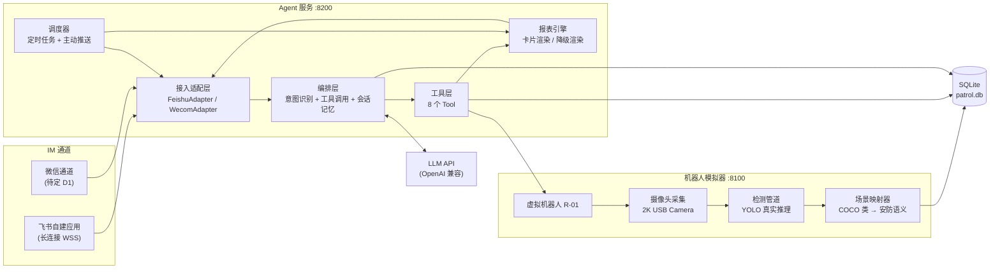

# 巡逻 Agent Demo 需求规格说明书（Spec）

> 配套文档：[[巡逻Agent_交互设计]] ｜ [[飞书开放平台配置清单]]
> 业务语义来源：[[巡逻场景：七大场景]]
> 归属：`91_实验项目/agent_patrol`（实验项目，与 `20_安全巡逻` 主项目分离，成熟后可迁入 `20_安全巡逻/05_研发协作`）
> 文档策略：评审期使用这份不带版本号的活动稿，定稿后再按 vault 规范落 `巡逻Agent_Spec_V1.0`

---

## 1. 目标与非目标

### 1.1 目标

在没有实体机器人的前提下，用**一台带摄像头的 PC** 搭出可端到端演示的巡逻 Agent，验证三件事：

| # | 验证目标 | 成功判据 |
|---|---|---|
| G1 | IM 里能用自然语言驱动巡逻业务 | 飞书发消息 → 任务真的下发并执行 → 结果回到飞书 |
| G2 | 报表与历史数据可对话式获取 | 一句话拿到日报/历史查询结果，不需要登录任何平台 |
| G3 | 检测告警能形成闭环 | 告警推送到 IM → 就地处置 → 状态回流 |
| G4 | **告警来自真实模型推理** | 每条告警都能追溯到 YOLO 的真实输出，非模拟数据 |

**V1 只求跑通，不求完整。** 两个点位、两个检测目标、一条飞书链路，端到端能演即达标。

### 1.2 非目标（明确排除）

- ❌ 真实机器人导航/运动控制（无实体）
- ❌ 生产级多租户、权限体系
- ❌ 视频墙、实时视频直播/遥控
- ❌ 模型训练与算法调优
- ❌ 私有化部署与高可用
- ❌ **行为类与环境设备类算法**（见 §5.4，COCO 80 类无法支撑）
- ❌ 周报（V1 只做日报，周报降为 V1.5）

---

## 2. 术语

| 术语 | 定义 |
|---|---|
| 点位 Point | 巡逻的最小单元，绑定一个业务标签和一个检测目标类别 |
| 路线 Route | 有序的点位集合 |
| 任务 Task | 「某机器人 + 某路线 + 某时间规则」的组合 |
| 巡逻轮次 Run | 任务的一次实际执行 |
| 检测 Detection | 一次拍照产生的单条模型输出（COCO 类别） |
| 告警 Alert | 由检测经场景映射与规则判定升级而来、需人工关注的记录 |
| 就位窗口 | 两个点位拍照之间的间隔，供现场摆放目标物以制造真实差异 |

---

## 3. 系统架构



**分层理由**：机器人模拟器与 Agent 服务是**两个独立进程**，通过 HTTP 通信。这样做的关键收益是——**将来把模拟器换成真机/真平台时，Agent 一行不用改**。这是本 Demo 最重要的架构决策。

---

## 4. 工程结构

工作区：`D:\code\patrol_agent`（当前为空目录，需 `git init`）

```
patrol_agent/
├─ README.md
├─ requirements.txt
├─ config/
│  ├─ config.example.yaml      # 配置模板（提交）
│  ├─ config.yaml              # 实际配置（.gitignore，含密钥）
│  ├─ routes.yaml              # 路线与点位定义（2 个点位）
│  └─ mapping.yaml             # 点位 → 目标类别 → 告警语义
├─ models/
│  └─ yolov8n.pt               # 权重（不入 git）
├─ robot_sim/                  # 机器人模拟器 :8100
│  ├─ main.py
│  ├─ robot.py                 # 虚拟机器人状态机
│  ├─ camera.py                # 摄像头采集（opencv）
│  ├─ detectors/
│  │  ├─ base.py               # Detector 抽象接口
│  │  ├─ yolo.py               # YOLO 真实推理（主路径，必需）
│  │  └─ mock.py               # 降级用（未装 ultralytics 时兜底）
│  └─ mapper.py                # COCO 类 + 点位标签 → 安防告警
├─ agent_service/              # Agent 服务 :8200
│  ├─ main.py
│  ├─ im/
│  │  ├─ base.py               # InboundMessage / OutboundMessage 抽象
│  │  ├─ feishu.py             # 飞书适配（长连接）
│  │  └─ wecom.py              # 微信适配
│  ├─ core/
│  │  ├─ orchestrator.py       # 编排主循环
│  │  ├─ intents.py            # 意图定义
│  │  ├─ memory.py             # 会话上下文
│  │  └─ llm.py                # LLM 客户端封装
│  ├─ tools/                   # 8 个工具
│  ├─ report/
│  │  ├─ builder.py            # 数据 → 报表模型
│  │  ├─ feishu_card.py        # 飞书卡片渲染
│  │  └─ plain_text.py         # 微信降级渲染
│  └─ scheduler.py             # APScheduler 定时推送
├─ shared/
│  ├─ db.py                    # SQLite 连接与迁移
│  ├─ models.py                # 数据模型
│  └─ schemas.py               # 接口契约
├─ scripts/
│  ├─ seed_demo.py             # 造历史数据，让日报一上来就好看
│  └─ demo.sh                  # 一键起服务
├─ logs/
└─ tests/
```

---

## 5. 功能需求 · 机器人模拟器

### 5.1 虚拟机器人状态

模拟一台机器人 `R-01`，维护并可查询：

| 字段 | 说明 |
|---|---|
| `online` | 在线状态 |
| `battery` | 电量，按时间衰减，低于 20% 触发低电量事件 |
| `current_point` | 当前点位 |
| `status` | `idle` / `patrolling` / `charging` / `offline` |

### 5.2 点位定义（V0.3 定型）

**2 个点位，共用同一台摄像头，各检测一个目标类别。**

| 点位 | 业务标签 | 检测目标 | 映射告警 | 图像来源 |
|---|---|---|---|---|
| `P1` | 人员检测 · 东侧通道 | `person` | **人员闯入** | 2K USB Camera 抓帧 |
| `P2` | 遗留物检测 · 西侧通道 | `book` | **遗留物** | 2K USB Camera 抓帧 |

**执行逻辑**：
1. 到达点位 → 抓取当前帧 → YOLO 推理 → 场景映射 → 落库
2. 点位之间插入 `dwell_sec`（默认 **30s**）的**就位窗口**
3. 完成全部点位 → 结束轮次

**就位窗口的用法（这是演示脚本的一部分）**：

| 现场动作 | 效果 |
|---|---|
| P1 拍照前**走到镜头前** | 真的检出 `person` → 人员闯入告警 |
| P2 拍照前**放一本书到镜头前并退开** | 真的检出 `book` → 遗留物告警 |
| 什么都不做 | 两帧一致，链路完整性依然可验证 |

**关键设计：每个点位只关心自己配置的目标类别。** 其他类别仍会落库进 `detection` 表（保留原始证据），但不生成告警。这样即使书一直在桌上、人也一直在画面里，两个点位的告警也不会互相污染。

### 5.3 检测管道

```python
class Detector(Protocol):
    def detect(self, image: np.ndarray) -> list[Detection]: ...
```

**主路径 `YOLODetector`**：
- 模型：`yolov8n.pt`（COCO 预训练，CPU 可跑，权重约 6MB）
- 依赖：`ultralytics`（会带入 torch，CPU 版磁盘占用约 1-2GB）
- 输出：全类别 `[(label, confidence, bbox)]`，按置信度阈值过滤（默认 0.35）
- **全类别输出 + 点位过滤**，而不是只检目标类。理由是保留原始证据，让"为什么没告警"也可解释

**降级 `MockDetector`**：
- 仅在未安装 `ultralytics` 时启用，启动日志与报表均明确标注
- 所有落库记录带 `is_mock=true`，**绝不允许与真实数据混淆**

**性能**：单帧 YOLOv8n CPU 推理 ≤ 500ms，两个点位共 2 帧，可忽略。

### 5.4 场景能力边界（说明为何只有两个点位）

YOLO COCO 80 类的真实能力边界，对照 [[巡逻场景：七大场景]] 的四类算法能力：

| 七大场景算法能力 | COCO 支撑 | V1 处理 |
|---|---|---|
| 人员类：越界闯入 / 徘徊逗留 / 聚集 / 禁区入侵 | ✅ 能（`person`） | ✅ **P1 实现（仅"人员闯入"一档）** |
| 物体类：遗留物 / 遗弃包裹 | 🟡 部分（`backpack` `handbag` `suitcase` `book` 等） | ✅ **P2 实现（用 `book` 代表）** |
| 物体类：通道占用 / 违规堆放 | 🟡 部分（`chair` `couch` 等） | ⏸ V1.5 |
| 物体类：封条状态识别 | ❌ 不能 | ❌ 排除 |
| 行为类：翻越攀爬 / 奔跑 / 聚众冲突 / 抽烟 | ❌ 不能 | ❌ 排除 |
| 环境设备类：烟火烟雾 / 漏水 / 围栏破损 / 门窗破损 / 消防设施损坏 / 照明失效 | ❌ 不能 | ❌ 排除 |

**结论**：V1 的真实检测目标 = **`person` 与 `book`**，对应**人员闯入**与**遗留物**两类告警。其余能力在 COCO 下无法产出，**明确不做**，绝不用模拟数据凑数。

**为什么用 `book` 代表遗留物**：COCO 里没有"遗留物"这个类。"遗留物品"的视觉本质就是"出现在不该出现位置的离散小物体"，`book` 是可靠、易布置、置信度高的代理目标，且语义上完全讲得通（书本遗落在通道 = 遗留物）。

**升级路径**（V2 可选）：换开放词汇检测模型（YOLO-World / GroundingDINO），用文本 prompt 直接检 `fire` / `smoke` / `wall damage` 等自定义词，即可覆盖更多场景。需重新评估办公室场景下的实际检出率。

### 5.5 场景映射与规则判定

```python
class SceneMapper:
    def map(self, detections, point) -> list[Alert]: ...
```

**映射规则**（配置于 `config/mapping.yaml`，改规则不改代码）：

| 点位 | 目标类别 | 置信度阈值 | 判定告警 | 等级 |
|---|---|---|---|---|
| `P1` | `person` | ≥ 0.60 | `人员闯入` | 紧急 |
| `P2` | `book` | ≥ 0.50 | `遗留物` | 一般 |

**规则近似说明**：「闯入」本质是**行为**，而 COCO 只提供 `person` 框。V1 的判定是「点位 P1 检出 person 且置信度达标 → 人员闯入」，可用 `zone` 配置扩展为「落在禁区多边形内才算闯入」。这是**规则近似，不是行为识别模型**，报表与卡片上必须如实标注，不宣称具备行为识别能力。

### 5.6 对外接口（REST）

| 方法 | 路径 | 说明 |
|---|---|---|
| GET | `/health` | 健康检查 |
| GET | `/robot/{id}/status` | 机器人状态 |
| POST | `/robot/{id}/tasks` | 下发任务 |
| GET | `/robot/{id}/tasks/{task_id}` | 任务详情 |
| DELETE | `/robot/{id}/tasks/{task_id}` | 取消任务 |
| POST | `/robot/{id}/capture` | 立即抓拍（body: `point_id`） |
| GET | `/routes` | 可用路线与点位列表 |
| POST | `/sim/advance` | **时间快进**（把轮次压缩到数秒，演示必备） |

> `POST /sim/advance` 是 Demo 可演示性的关键：默认 2 个点位约 1 分钟，评审会上仍需加速。

### 5.7 任务执行仿真

- 接收任务后进入 `patrolling`，按点位顺序推进
- 每个点位：抓帧 → 推理 → 映射 → 落库（耗时受 `dwell_sec` 控制）
- 命中规则的检测升级为 Alert 并**回调 Agent 服务** `POST /internal/alert`
- 全部点位完成 → 生成 Run 记录 → 回调 Agent `POST /internal/run-finished`

---

## 6. 功能需求 · Agent 服务

### 6.1 编排主循环

```
收到消息 → 归一化为 InboundMessage
        → 载入该会话最近 N 轮上下文
        → LLM 意图识别（输出 intent + slots）
        → 槽位校验与补全（缺失则单选式追问，最多 1 轮）
        → 若为写操作：渲染确认卡并挂起（写入 pending_actions）
        → 若为读操作：调用工具 → 渲染卡片 → 回复
```

> ⚠️ **F1 强制要求**：system prompt 必须注入**当前日期与星期**。实测 LLM 会把「昨天」解析成 `2026-07-15`（训练数据里的日期），导致所有相对时间查询全错。注入后需复测「昨天 / 上周 / 最近三天」三种表述。

### 6.2 意图与工具映射

意图清单见 [[巡逻Agent_交互设计]] 第 3 节。工具清单：

| 工具 | 签名（简化） | 对应意图 |
|---|---|---|
| `create_patrol_task` | `(route_id, start_at, repeat, robot_id) -> task` | `task.create` |
| `list_tasks` | `(status, limit) -> list[task]` | `task.list` |
| `cancel_task` | `(task_id) -> ok` | `task.cancel` |
| `get_report` | `(kind, date_range) -> ReportModel` | `report.*` |
| `query_history` | `(date_range, alert_type, point, limit) -> list[detection]` | `history.query` |
| `get_robot_status` | `(robot_id) -> status` | `robot.status` |
| `capture_now` | `(point_id) -> image_path` | `snapshot.now` |
| `handle_alert` | `(alert_id, action) -> ok` | `alert.handle` |

### 6.3 会话记忆

- 按 `chat_id` 维护最近 **10 轮**对话
- 支持**指代消解**："第 2 条是误报" 需能关联到上一条列表卡片的具体记录
  - 实现：列表卡片渲染时把 `alert_id` 列表存入会话上下文
- 记忆过期：30 分钟无交互则清空（避免陈旧指代）

### 6.4 待确认动作（防幻觉核心机制）

- 写操作解析结果写入 `pending_actions` 表，带 `expires_at`（默认 10 分钟）
- 用户点击确认 → 校验 `pending_action` 是否过期 → 执行
- 这是**唯一允许触碰机器人模拟器写接口的路径**，编排层不直接调用 `POST /tasks`

### 6.5 报表引擎

| 报表 | 数据来源 | 关键指标 | V1 |
|---|---|---|---|
| 日报 | runs + detections + alerts | 任务完成率、覆盖率、告警数、待处置数、离线次数 | ✅ |
| 告警清单 | alerts | 按等级/状态/时间排序 | ✅ |
| 周报 | 日报聚合 | 趋势、环比、异常类型分布 | ⏸ V1.5 |

**覆盖率 / 路径完成率** 的正确定义参见 [[巡逻覆盖率和路径完成率]] 与 [[安防巡逻覆盖率KPI-深度规格]]，Demo 阶段先用简化口径并在报表脚注标注。

### 6.6 主动推送

| 触发 | 接收方 | 形态 |
|---|---|---|
| 新告警（等级 ≥ 一般） | 值班员私聊 | `alert_card` + 图片 |
| 巡逻轮次完成 | 任务发起人 | 结果摘要卡 |
| 日报（每日 08:30，可配） | 主管私聊 | `report_card` |
| 机器人低电量/离线 | 值班员 | 文本告警 |

---

## 7. 功能需求 · IM 接入

### 7.1 飞书（V1 必须）

> 📋 逐步操作见 [[飞书开放平台配置清单]]

- **接入方式：自建应用 + 长连接（WebSocket）**
  - 理由：本地 PC 无公网 IP，长连接**免内网穿透、免公网域名、免 HTTPS 证书**。这是本地 Demo 唯一现实的选择。
- ⚠️ **不能复用 DSH 已连通的飞书应用**（`cli_aa4d0673ee389bd8`）：飞书长连接**一个应用只能有一个消费者**，DSH 正在占用。需**新建一个自建应用**。
- 需订阅事件：`im.message.receive_v1`、卡片回调 `card.action.trigger`
- 需权限（4 项）：`im:message.p2p_msg:readonly`（收私聊）、`im:message.group_at_msg:readonly`（收群内@）、`im:message:send_as_bot`（发消息）、`im:resource`（发图/文件）
- 群聊策略：**仅 @机器人 时响应**，私聊直接响应

### 7.2 微信（V1 验证基础下发/查询）

- **通道形态待定（见交互设计 D1）**，倾向**企业微信自建应用**
- V1 只需验证：文本下发任务 + 文本查询报表
- 卡片能力缺失 → 走 `plain_text.py` 降级渲染 + 编号回复协议

### 7.3 适配层抽象

```python
class IMAdapter(Protocol):
    async def send_text(self, chat_id, text) -> str: ...
    async def send_card(self, chat_id, card) -> str: ...
    async def update_card(self, message_id, card) -> None: ...
    async def send_image(self, chat_id, path) -> str: ...
    def capabilities(self) -> Capabilities: ...
```

`capabilities()` 决定报表引擎走卡片还是降级渲染——**业务代码不感知通道差异**。

---

## 8. 数据模型

```sql
robot(id, name, model, status, battery, current_point, online, last_seen_at)

point(id, name, area, target_label, conf_threshold, zone_json)
route(id, name, description)
route_point(route_id, point_id, seq, dwell_sec)

task(id, robot_id, route_id, start_at, repeat_cron, status,
     created_by, created_at, source_channel)
patrol_run(id, task_id, robot_id, started_at, ended_at, status,
           points_total, points_done)

detection(id, run_id, point_id, coco_label, confidence,
          bbox_json, image_path, is_mock, created_at)
alert(id, detection_id, level, alert_type, status,   -- pending|confirmed|false_positive
      handled_by, handled_at, pushed_at, card_message_id)

message(id, channel, chat_id, user_id, direction, content_json, created_at)
pending_action(id, chat_id, user_id, intent, payload_json,
               status, expires_at, created_at)
```

**可追溯性要求（关键）**：`detection` 存**原始 COCO 输出**（全类别），`alert` 存**映射后语义**，两者分离。每条 Alert 必须能溯源到 `detection → patrol_run → task → 发起人`。

这是"报表能不能当证据"的前提——客户追问"你凭什么说这是人员闯入"时，能拿出原始模型输出与抓拍原图。**这也是本 Demo 相对"假数据演示"的核心价值所在。**

---

## 9. 非功能需求

| 项 | 要求 |
|---|---|
| 响应时延 | 读操作 ≤ 3s（不含 LLM）；写操作回执 ≤ 2s |
| 单帧推理时延 | YOLOv8n CPU ≤ 500ms |
| LLM 时延兜底 | 超过 3s 先回占位消息，完成后 patch 更新 |
| 幂等 | 飞书可能重复推送，**必须用 `message_id` 去重**（官方明确：不要依赖 `event_id`） |
| 配置外置 | 所有密钥走 `config.yaml` / 环境变量，**不入库、不进 git** |
| 日志 | 结构化日志落 `logs/`，按天切分 |
| 数据保留 | Demo 数据保留 90 天 |
| 图像留存 | 告警原图保留 90 天，路径入库 |

---

## 10. 验收标准（Demo 版）

**主验收脚本（5 分钟，评审会现场跑）**

| # | 操作 | 预期 |
|---|---|---|
| 1 | 飞书私聊：「昨天的巡逻报表」 | 10 秒内返回日报卡片 |
| 2 | 「让机器人去巡逻一圈」 | 返回确认卡，核对为 2 个点位 |
| 3 | 点「确认下发」 | 回执卡带任务号 |
| 4 | **P1 就位窗口内走到镜头前**；用 `/sim/advance` 加速 | 飞书**主动收到**人员闯入告警卡（带真实抓拍图） |
| 5 | **P2 就位窗口内放一本书并退开** | 收到遗留物告警卡（带真实抓拍图） |
| 6 | 点「标记误报」 | 原卡片就地更新为已处置 |
| 7 | 「上周有没有人员闯入的告警」 | 返回历史查询卡，**刚处置那条状态正确** |
| 8 | 微信侧重复步骤 1 和 2 的文本版 | 文本降级版正常返回 |

**通过判据**：8 步全过，无人工干预，无报错弹窗。

**真实性判据（这条不能被绕过）**：步骤 4、5 的告警必须能在库里各追到一条 `is_mock=false` 的 detection，且其 `coco_label` 分别为 `person` 与 `book`。

---

## 11. 里程碑

| 阶段 | 内容 | 预估 |
|---|---|---|
| M0 | 工程骨架 + git init + 配置体系 + SQLite | 0.5 天 |
| M1 | 机器人模拟器：状态机、摄像头、YOLO 推理管道、场景映射、REST | 2 天 |
| M2 | 数据模型 + `seed_demo.py` 造历史数据 | 0.5 天 |
| M3 | Agent 编排 + 8 个工具 + 意图路由 | 2 天 |
| M4 | 报表引擎 + 飞书卡片渲染 | 1 天 |
| M5 | 飞书长连接接入打通（**含你需要在开放平台的操作**） | 1 天 |
| M6 | 主动推送 + 告警就地处置（patch 卡片） | 1 天 |
| M7 | 微信通道 + 降级渲染 | 1 天 |
| M8 | 演示脚本打磨 + 稳定性 | 0.5 天 |

**合计约 9.5 人天**（不含模型下载与平台审核等待时间）。

**最小可演示版本（MVP）**：M0-M6 = **8 天**，先把飞书链路做扎实，微信后置。

> 注意：M5（飞书接入）依赖你先在开放平台建应用，**这是唯一的外部阻塞项**，建议立刻并行办理。

---

## 12. 风险与依赖

| # | 风险 | 影响 | 对策 |
|---|---|---|---|
| R1 | **飞书自建应用需你手动创建并配权限** | 阻塞 M5 | 需提供 App ID / Secret，并在开放平台开启「长连接」订阅方式 |
| R2 | 微信个人号无官方 API，第三方方案有封号风险 | 阻塞 M7 | 改用企业微信自建应用；若坚持个人微信需签署风险确认 |
| R3 | 两个点位共用一台摄像头，画面相同 | 演示单薄 | 就位窗口（§5.2）供现场摆人/摆书制造真实差异；不改代码 |
| R4 | **COCO 80 类覆盖不了烟火/行为/设备破损** | **已收窄范围** | §5.4 明确排除，不用模拟数据凑数；V2 可换开放词汇模型 |
| R5 | `ultralytics` 带入 torch（约 1-2GB） | 装环境慢 | 标为必需依赖，环境准备阶段先装；保留 Mock 降级 |
| R6 | `book` 在远景/侧视下检出率低于 `person` | 中 | 演示时把书放到镜头前 1-2 米内、正面朝向；必要时降到 `yolov8s.pt` |
| R7 | 行为判定用规则近似，非真实行为识别 | 中 | 报表与卡片如实标注，不宣称行为识别能力 |
| R8 | 报表"覆盖率"口径若不统一，数字会被质疑 | 中 | 明确复用现有 KPI 定义并标注口径来源 |
| R9 | LLM 幻觉下发错误任务 | 中 | 二次确认卡机制（§6.4）为强制路径 |

### 需要你提供/操作的前置项

- [x] **飞书自建应用**：✅ 完成并实测（`cli_aa44…`（见本地 `config/config.yaml`，不随仓库分发），机器人「巡逻agent」）——长连接、收消息、发文本、发图片、发卡片、按钮回调、PATCH 更新，**7 项全通过**
- [x] **LLM**：✅ DeepSeek 官方 API（`deepseek-chat`），function calling 实测稳定
- [x] 点位业务标签：✅ `P1 人员检测·东侧通道` / `P2 遗留物检测·西侧通道`
- [x] 部署位置：✅ 本机
- [ ] 演示现场配合就位动作（P1 站人、P2 放书）——演示当天确认
- [ ] 微信通道形态——延后，飞书跑通后再定

---

## 13. 待决问题

**已于 2026-10-13 全部确认：**

| # | 问题 | 结论 |
|---|---|---|
| Q1 | 单机 vs 多机 | ✅ **单机 R-01**，数据模型保留 `robot_id` 以便日后扩展 |
| Q2 | 历史数据导出 CSV | ⏸ **延后**，不进 V1 |
| Q3 | 证据链（回溯抓拍原图 + 原始 COCO 输出） | ✅ **进 V1** |
| Q4 | 部署位置 | ✅ 本机（`2K USB Camera` 在此） |
| Q5 | 场景范围 | ✅ 只做 `person` / `book` |
| Q6 | LLM | ✅ **DeepSeek 官方 API**（`deepseek-chat`） |
| Q7 | 微信通道 | ⏸ **延后**到飞书链路跑通之后 |
| Q8 | 推送策略 | ✅ 告警实时推 + 日报每日 08:30 定时推 |

**联调阶段新发现的约束：**

| # | 发现 | 影响 |
|---|---|---|
| F1 | **LLM 不知道当前日期**——实测「昨天」被解析为 `2026-07-15`（真实日期 2026-10-13） | **system prompt 必须注入当前日期**，否则所有相对时间全错 |
| F2 | DeepSeek 单次调用实测 0.6–1.0s，function calling 稳定 | 在 3s 事件超时内；编排仍走异步回填更稳 |
| F3 | 卡片更新两条路径均已实测通过：按钮回调 → **回调响应返回卡片**；异步 → **PATCH API** | 按钮处置走前者；巡逻完成/报表回填必须走后者 |
| F4 | 飞书长连接集群模式不广播，一个应用只能有一个消费者 | 本地开发只跑一个客户端进程 |

---

## 14. 变更记录

| 版本 | 日期 | 变更 |
|---|---|---|
| V0.1 | 2026-10-13 | 初稿。基于 4 项决策：Python 全自研 / 混合检测 / 复用七大场景 / 飞书优先 |
| V0.2 | 2026-10-13 | 点位简化为 2 个、共用摄像头、仅业务标签不同；检测改为 YOLO 真实推理为唯一主路径；新增场景能力边界并据此收窄范围；新增就位窗口设计 |
| V0.3 | 2026-10-13 | **定点位检测目标：P1=`person`（人员闯入）、P2=`book`（遗留物）**；映射表收敛为 2 条规则；周报降为 V1.5；新增"点位只关心自身目标类别"设计；验收脚本细化为 8 步并加真实性判据；新增 R6（book 检出率） |
| V0.4 | 2026-10-13 | 依飞书官方文档修正幂等策略（改用 `message_id` 去重，`event_id` 不可靠）；新增配套文档 [[飞书开放平台配置清单]] |
| V1.0 | 2026-10-13 | **评审通过，进入开发**。8 项待决问题全部确认（§13）；前置项完成飞书应用与 LLM 接入并实测通过；新增联调发现 F1–F4 |
| V1.1 | 2026-10-14 | 新增**附录 A · 实现现状**：记录「点位绑定算法」模型、告警抑制、数据模型实际字段、指标口径修正、实测数据、8 个已踩的坑、尚未实现清单。正文为设计意图，附录为实现事实，冲突以附录为准 |

---

_最后更新：2026-10-14 · 状态：开发中（已实现并可端到端演示，见附录 A）_


---

# 附录 A · 实现现状（截至 2026-10-14）

> 本附录记录**代码里实际是什么样**，以及与原规格的偏差与原因。
> 正文（§1–§14）是设计意图，本附录是实现事实。两者冲突时**以本附录为准**，
> 因为它对应的是可运行的代码。

## A.1 「点位绑定算法」是核心模型

原规格把绑定写成 `point.target_label`（一个散落的字段），实现时改成了显式建模：

```
算法 algorithms        = 一类检测能力（有名字、模型类别、映射出的告警语义）
点位 points[].algorithm = 绑定关系：绑定了谁，就只上报谁的检测结果
```

`target_label` 不再单独配置，而是**从绑定算法派生** ——
杜绝「点位写着 person、算法却是通道占用」这种自相矛盾的配置。
点位未绑算法会**直接抛错**，不静默降级。

绑定生效的范围：

| 输出 | 受绑定约束 | 说明 |
|---|---|---|
| 告警 | 是 | 只有绑定算法产生告警 |
| 算法结果图上的框 | 是（默认） | `detector.show_other_detections: false` |
| 「拍一张照片」的文字回显 | 是 | capture 接口只返回绑定算法的检出 |
| 内部检测表留档 | 可配 | `detector.store_all_classes`，默认 `true` |

**关于 `store_all_classes` 的取舍**：保留全类别是**内部留档，不是「上报」**，
好处是客户追问「那个点位当时到底看到什么」时答得出来。
若要求数据模型严格做到「一个点位只有一种算法的数据」，改为 `false`。

## A.2 告警抑制（原规格没有，实现中新增）

**问题**：原实现下同一个目标每次巡逻都新建一条告警。实测 10 条真实告警里
**9 条是同一个人在同一个点位的重复报警**，值班员会被淹没。

**实现**：同一 `(点位, 告警类型)` 在 `alert_policy.suppress_minutes`（默认 30）
内已有**未处置**告警时，不新建而是：

- `occurrence_count` 累加
- `last_seen_at` 刷新，`detection_id` 指向**最新一次**的检测（卡片展示当前画面）
- Agent 侧**就地 PATCH 原卡片**，显示「已持续 X · 出现 N 次」

判定基准用 `COALESCE(last_seen_at, created_at)`：目标持续出现则一直是同一条告警；
消失超过窗口后再出现才算新事件。

## A.3 数据模型的实际字段（对照 §8）

`detection` 新增：

| 字段 | 用途 |
|---|---|
| `raw_image_path` | 原始帧路径。`image_path` 是标注帧（带框、给用户看），原始帧是**证据本体** |

`alert` 新增：

| 字段 | 用途 |
|---|---|
| `resolution_note` | **处置结论**。只有 who/when 无法复用经验，这是做「上次类似情况怎么处理的」的前置 |
| `occurrence_count` | 同一事件累计出现次数（抑制用） |
| `target_count` | 本次拍照里命中该目标的**个数**（画面里 3 人 → 3） |
| `last_seen_at` | 最近一次出现时间 |

`point` 新增 `algorithm_id`；另有 `id_seq` 表用于流水号生成（见 A.7）。

## A.4 指标口径修正（原 §6.5 的指标名有误）

| 原规格 | 实现 | 原因 |
|---|---|---|
| 「覆盖率」 | **「路径完成率」** | 原值只是「已完成点位/应巡点位」，不是 KPI 定义里含时间维度的「巡逻覆盖率」。名字用错，客户按自己的定义理解，一问就穿帮 |
| 「检测记录 N 条」 | **「拍照 N 次 · 检出目标 M 个」** | 原来统计的是 detection 表行数（= 检出目标数），会被读成「检测了 N 次」。实测拍照 26 次、检出 55 个目标，那个数字是错的 |

模拟数据（`is_mock=1`）在报表里按比例明确标注，不与真实推理混算。

## A.5 实测结论（可直接引用的数据）

| 项 | 实测值 | 备注 |
|---|---|---|
| YOLOv8n CPU 单帧推理 | **47 ms**（首帧预热 ~1.8 s） | 已做预热，不占演示时间 |
| 摄像头首次打开 | ~6 s（MSMF 后端） | 所以模拟器**常驻持有**摄像头，不每次重开 |
| `person` 检出率 | **0.87–0.95**，61/61 帧稳定 | P1 的绑定算法 |
| `chair` 检出率 | 0.35–0.72 波动 | P2 的绑定算法，阈值设 0.45 |
| `book` 检出率 | **0/60 帧，完全检不出** | 已放弃，改用 chair |
| DeepSeek 单次调用 | 0.6–1.0 s | function calling 稳定 |

**能力边界（必须如实对外）**：本版本只有 `person` 与 `chair` 两个算法。
烟火、翻墙、漏水、聚集等场景 COCO 覆盖不了，**明确不做，也不用模拟数据凑数**。

## A.6 实现中踩的坑（后续维护者请先读这一节）

| 坑 | 现象 | 教训 |
|---|---|---|
| 把卡片写成 `[卡片] 标题` 存进对话历史 | LLM 学会这个「格式」，不再调工具，直接吐一句没有数据的假卡片文案 | **任何可模仿的输出模板都不能进 assistant 轮次**。卡片/图片一律不写历史 |
| 卡片回调同步处理 | 超过 3 秒触发飞书超时重试，且长连接单线程被堵住，后续消息一起变慢 | 回调**必须 3 秒内返回**：立刻回 toast，干活丢后台，干完 PATCH 就地更新 |
| `detection_ids[0]` 关联告警 | P2 检出 `[person 0.92, chair 0.46]`，告警是 chair 却关联到 person，卡片显示「通道占用 · 原始输出 person 0.92」 | 要按**对象身份**匹配触发告警的那条检测，不能取下标 |
| `Camera.probe()` 无条件 `close()` | `/health` 会调它 —— 任何一次健康检查都关掉常驻摄像头，下次抓帧重开要 6 秒 | 自检不该动共享句柄 |
| `next_id` 用 `COUNT(*)+1` | seed 用全局计数器直接写 ID，两者规则不一致；一次跳号就撞主键，**用户点「确认下发」收到 500** | 编号必须用**独立计数器 + 存在性校验**，不能用 COUNT 推 |
| LLM 不知道当前日期 | 「昨天」被解析成训练数据里的日期 | system prompt **必须注入当前日期** |
| 用 `event_id` 去重 | 去重失效 | 飞书官方明确：用 `message_id` 去重 |
| 依赖 PATH 里的 python | 本机 PATH 指向另一个工具的 venv，装 torch 会污染它 | **项目独立 venv** |

## A.7 尚未实现（如实记录，不要假装已有）

| 项 | 状态 |
|---|---|
| 定时 / 重复巡逻 | ❌ `task.start_at` / `repeat_cron` 字段保留但**无调度器读取**。API 对未来的 `start_at` 明确返回 501，工具描述与确认卡也已移除承诺 |
| 微信通道 | ❌ 飞书已完整验证，微信计划下一版 |
| 角色与权限 | ❌ 告警目前 `broadcast_card` 发给**所有**已知联系人，且可能发到群里。上线前必须区分值班员/主管，并强制私聊 |
| 周报 | ❌ 只有日报 |
| 越界闯入的区域判定 | ⚙️ `zone` 字段与 `point_in_zone()` 已实现，但配置里未启用 |
| 行为识别 | ❌ 「闯入/徘徊」是**规则近似**（点位检出即判定），不是行为识别模型，对外不得宣称 |

## A.8 代码与文档的对应关系

| 文档章节 | 对应实现 |
|---|---|
| §3 系统架构 | `robot_sim/` + `agent_service/` 双进程 |
| §5.2 点位定义 | `config/routes.yaml` + `shared/scene.py` |
| §5.5 场景映射 | `config/mapping.yaml` + `robot_sim/mapper.py` |
| §6.1 编排主循环 | `agent_service/core/orchestrator.py` |
| §6.4 待确认动作 | `shared/repo.py` 的 `pending_action` + `agent_service/tools/patrol.py` |
| §7.1 飞书接入 | `agent_service/im/feishu.py` |
| §8 数据模型 | `shared/db.py`（SCHEMA）+ `shared/repo.py` |
| §10 验收标准 | `scripts/smoke_robot_sim.py` + `scripts/test_agent_local.py` |
